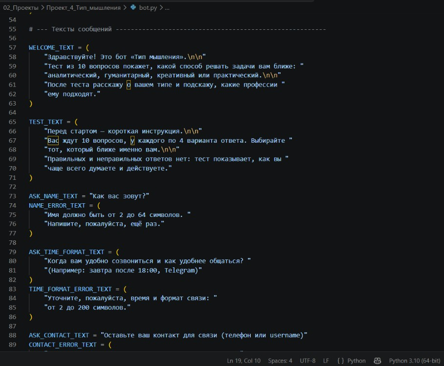
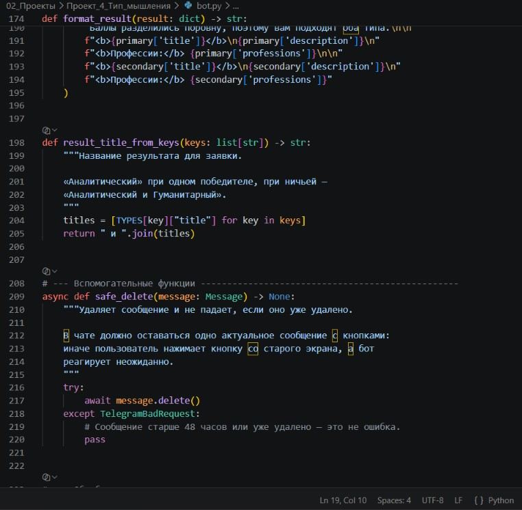
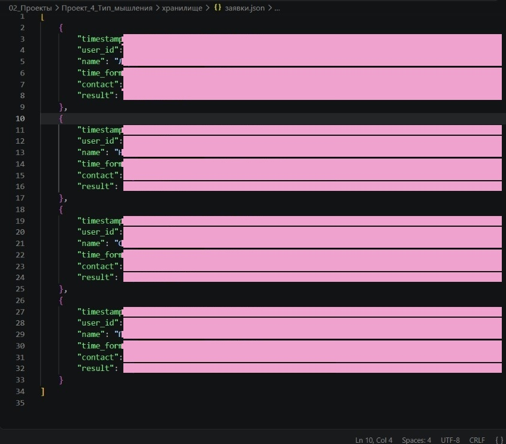

# Проект 4. Telegram-бот «Тип мышления»

Бот [@MyMindTypeBot](https://t.me/MyMindTypeBot): тест из 10 вопросов определяет преобладающий тип
мышления (аналитический, гуманитарный, креативный, практический), выдаёт
результат с описанием и профессиями, собирает заявки на консультацию
и отправляет их менеджеру в Telegram.

## Что делает бот (по ТЗ)

- `/start` — приветствие и кнопка «Начать тест».
- Инструкция, затем 10 вопросов по 4 варианта ответа.
- Подсчёт баллов по четырём типам; при ничьей показываются оба типа.
- Результат: тип мышления, описание, подходящие профессии.
- Кнопка «Оставить заявку»: имя → удобное время и формат связи → контакт.
- Заявка сохраняется в `хранилище/заявки.json`, детали уходят менеджеру
  на `MANAGER_CHAT_ID` из `.env` (если id не задан — печать в консоль).
- `/reset` сбрасывает любой шаг и возвращает в меню.

## Стек

- Python 3.10, `aiogram` 3.7.0 (FSM на `MemoryStorage`).
- `python-dotenv` — токен, прокси и id менеджера из `.env`.
- `unittest` — 28 тестов логики, формы и хранилища.

## Структура проекта

| Путь | Что лежит |
| --- | --- |
| `bot.py` | сценарий: экраны, машина состояний, уведомление менеджеру |
| `данные/types.py` | четыре типа: названия, описания, профессии |
| `данные/questions.py` | 10 вопросов, веса ответов, `calculate_result()` |
| `хранилище/заявки.py` | запись заявок в JSON с защитой от битого файла |
| `хранилище/заявки.json` | заявки (в репозиторий не идут) |
| `тесты/test_бот.py` | 28 тестов на `unittest` |
| `схема_бота.json` | граф сценария: экраны, события, переходы, состояния |
| `README.md` | описание проекта и сценарий демо |
| `Медиа/` | скриншоты работы: аватарка бота и код |

## Запуск (Windows, PowerShell)

```powershell
# 1. Установить зависимости
pip install -r requirements.txt

# 2. Скопировать .env.example в .env и вписать токен от @BotFather
# 3. Вписать свой Telegram-id в MANAGER_CHAT_ID (узнать его можно
#    из консоли после первой тестовой заявки)

python bot.py
```

Если api.telegram.org недоступен напрямую — вписать прокси в `.env`:
`PROXY_URL=http://host:port`.

## Тесты

```powershell
python -m unittest discover -s тесты -v
```

28 тестов: победа и ничья в подсчёте, валидация полей формы (имя 2-64,
время и формат 2-200, контакт 3-100), сохранение заявок на временном
файле, защита от старых кнопок, связка «результат → заявка».

## Логика подсчёта и ничья

Каждый вариант ответа добавляет 1 балл своему типу. Побеждает тип
с максимальной суммой (максимум 10 баллов). Если два типа набрали
поровну — бот показывает оба: «Вы между „Аналитическим"
и „Гуманитарным"», с описаниями и профессиями каждого.

## Схема бота

Граф сценария лежит в `схема_бота.json`: 11 экранов (приветствие,
инструкция, цикл из 10 вопросов, результат, три шага формы,
благодарность, экран ошибки), 11 переходов, 4 FSM-состояния, 5 точек
выхода.

Главный путь: `/start` → «Начать тест» → инструкция → 10 вопросов →
результат → «Оставить заявку» → имя → время и формат → контакт →
«Спасибо! Мы свяжемся с вами в ближайшее время» → детали заявки
у менеджера.

Особенности:

- защита от старых кнопок: сверка `message_id` активного экрана;
- результат теста передаётся в форму через `callback_data` кнопки
  (`book_consult:analytical`, при ничьей — два ключа), поэтому
  `state.clear()` после теста ничего не теряет;
- `/start` и `/reset` прерывают форму из любого шага, команда
  не попадает в поле.

## Уведомление менеджеру

`notify_manager()` читает `MANAGER_CHAT_ID` из `.env` и отправляет
менеджеру детали заявки: имя, время и формат, контакт, результат теста.
Если id не задан или Telegram его не принял — заявка печатается
в консоль вместе с Telegram-id отправителя (его можно вписать в `.env`).
Бот при этом не падает.

## Скриншоты работы

Оформление бота и аватарка для Telegram:


Код: тексты приветствия, вопросов и проверок ввода —



подсчёт результата и сборка описания типа мышления —



и хранилище заявок: ключи видны, персональные данные заявок закрыты.



## Что показать на демо

Сценарий для видео (2-3 минуты):

1. `/start` — приветствие с кнопкой «Начать тест».
2. Нажать «Начать тест»: инструкция и вопрос 1.
3. Пройти 3-4 вопроса быстро, показать, что старые сообщения удаляются,
   в чате один актуальный экран.
4. Пройти все 10 вопросов — показать результат: тип, описание,
   профессии (например, «Аналитический»).
5. Отдельно показать ничью: ответить так, чтобы два типа набрали
   поровну, — бот выведет оба типа.
6. «Оставить заявку»: имя, время и формат, контакт. Показать ошибку
   валидации (например, имя из одной буквы), затем корректный ввод.
7. «Спасибо! Мы свяжемся с вами в ближайшее время».
8. Переключиться на чат менеджера (или консоль) — детали заявки пришли.
9. `/reset` посреди формы — бот вернулся в меню.

## Артефакты проекта

| Артефакт | Файл | Статус |
| --- | --- | --- |
| Код бота | `bot.py`, `данные/`, `хранилище/` | Готов, `pycodestyle` 0 замечаний |
| Схема | `схема_бота.json` | Готова: 11 экранов, 11 переходов |
| Тесты | `тесты/test_бот.py` | Готовы: 28 тестов, все зелёные |
| Документация | `README.md` | Готова |
| Скриншоты | `Медиа/` | Аватарка бота и код |
| Видео-демонстрация | — | Не записана |
| Публикация на GitHub | `mind-type-bot` | Опубликовано |

## Решённые вопросы

- UX главного меню: лишняя кнопка «Записаться на консультацию»
  убрана (заявка доступна только после результата теста).
- Результат теста переживает `state.clear()`: ключи типов передаются
  в `callback_data`.
- Безопасный фолбэк уведомлений: без `MANAGER_CHAT_ID` бот не падает,
  а печатает заявку в консоль.

## Открытые вопросы

- Вписать реальный `MANAGER_CHAT_ID` в `.env` (сейчас заявки
  дублируются в консоль).
- Ссылка на Telegram-канал по профориентации (по ТЗ) — пока не встроена.
- Записать видео-демонстрацию.

## Правила безопасности

- Токен, прокси и id менеджера — только в `.env`, файл в `.gitignore`.
- `хранилище/заявки.json` — персональные данные, в репозиторий не идёт.
- Учебные материалы Zerocoder (`_Документы/`, ТЗ, тетрадь) в репозиторий
  не входят.
- В коде и репозитории нет токенов и ключей.
